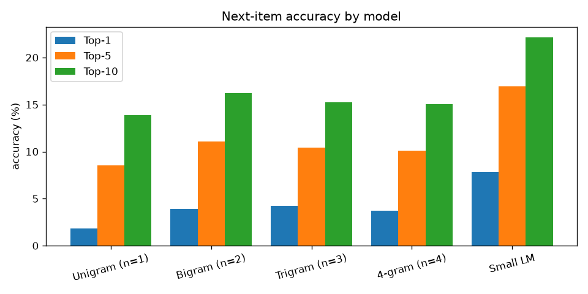
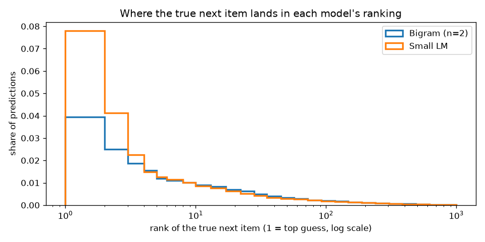

# Retail Basket Prediction Analyzer

[](https://ask.thili.ai/b/cwp76fetft)
[](https://github.com/Subhash-2910/retail-basket-prediction-analyzer/actions/workflows/ci.yml)

A command-line tool for retail analysts. It compares how well two models predict **the next item a shopper puts in
the basket**: a classic **n-gram model** (orders 1-4) and a **small transformer language model** trained from scratch.
Both are trained on the same simulated shopping baskets, which contain itemsets planted at known supports.

## Results

30,000 simulated baskets (1,000 products, 32 planted itemsets), split 80/20 into train and test. At each position in
a test basket, a model ranks every product not yet in the basket. The rank of the true next item gives the metrics.

| Model | Top-1 | Top-5 | Top-10 | MRR | Mean rank | Median rank |
|---|---:|---:|---:|---:|---:|---:|
| Unigram (n=1) | 1.8% | 8.5% | 13.9% | 0.063 | 181.0 | 90 |
| Bigram (n=2) | 3.9% | 11.0% | 16.2% | 0.085 | 189.4 | 96 |
| Trigram (n=3) | 4.2% | 10.4% | 15.3% | 0.084 | 192.0 | 99 |
| 4-gram (n=4) | 3.7% | 10.1% | 15.1% | 0.080 | 192.1 | 99 |
| **Small LM** | **7.8%** | **16.9%** | **22.2%** | **0.131** | 181.3 | **86** |

| Top-5 accuracy | Bigram | Small LM |
|---|---:|---:|
| Next item completes a planted itemset (8,017 positions) | 44.2% | **85.9%** |
| Ordinary positions (43,030) | 4.9% | 4.1% |

**Insights**

- **The small LM wins overall** (top-5 16.9% vs 11.0%, MRR 0.131 vs 0.085). It roughly doubles top-1 accuracy.
- **The gap is all in the planted itemsets.** When the basket already holds part of a planted itemset, the LM finds the
  missing item 86% of the time, against 44% for the bigram. Items arrive in random order, so the item that signals
  "this shopper is making biryani" is often not the last one. The n-gram sees only the last 1-3 items; the LM reads
  the whole basket so far.
- **Higher n-gram orders do not help.** Trigram and 4-gram are slightly worse than bigram: with 1,000 products, longer
  contexts are almost never seen twice, and in a randomly ordered basket the exact sequence carries no extra meaning.
- **Without a co-purchase signal, nobody can do better than popularity.** On ordinary positions, every model scores
  about 4-5% top-5, close to the plain popularity (unigram) baseline.
- The LM is most ahead in categories that make up planted sets (Household and Cleaning 15.9% vs 5.3%, Pulses 14.4% vs
  6.4%). The n-gram is slightly ahead where plain best-sellers dominate (Oils and Ghee, Bakery).

The full report with breakdowns by category is in [results/report.md](results/report.md).




## How it works

| Step | Code | What it does |
|---|---|---|
| 1. Data | `app/core.py` (`generate_baskets`) | Uses the generator from *Teach a Language Model What Sells Together* (`thilimarketbasket`): a 1,000-SKU grocery catalogue, popularity-weighted background baskets, and 32 natural and "surprising" itemsets planted at 5%, 1%, 0.2% and 0.05% support. Each basket becomes a sequence of distinct items. |
| 2. N-gram | `app/core.py` (`NGramModel`) | Counts which item follows each context of the last n-1 items (with a start token), using stupid backoff down to add-one popularity. Basket order is random, so each training basket is counted in 5 random orders. |
| 3. Small LM | `app/lm.py` | A 2-layer causal transformer (about 525k parameters, one token per item, tied embeddings, **no position embeddings** because order is meaningless). It follows the drill's pretraining recipe: next-token loss, a fresh random basket order every epoch, AdamW, warmup and cosine decay, gradient clipping, and a validation loss. Trains in about 100 s on a laptop CPU. |
| 4. Evaluation | `app/core.py` (`metrics`, `evaluate_ranks`) | Both models score the same test baskets in the same fixed order. Items already in the basket are excluded. Reports top-1/5/10 accuracy, MRR, and mean and median rank, overall, for planted vs ordinary positions, and by category. |
| 5. Comparison | `app/cli.py` (`compare`) | Writes `results/report.md`, the accuracy and rank-distribution charts, and insights computed from the numbers. An optional `--summary` adds a plain-English summary from the LLM set in `.env`. |

## Run it with Docker (recommended)

You only need [Docker Desktop](https://www.docker.com/products/docker-desktop/). No GPU is needed.

```bash
docker build -t basket .
docker run --rm -v "$PWD":/app basket python -m app.cli all        # generate, train, evaluate, compare (~2 min)
docker run --rm -v "$PWD":/app basket pytest                       # tests
```

Or run the steps one at a time:

```bash
docker run --rm -v "$PWD":/app basket python -m app.cli generate   # -> data/
docker run --rm -v "$PWD":/app basket python -m app.cli train      # -> models/lm.pt
docker run --rm -v "$PWD":/app basket python -m app.cli evaluate   # -> results/metrics.json
docker run --rm -v "$PWD":/app basket python -m app.cli compare    # -> results/report.md + charts
docker run --rm -v "$PWD":/app basket python -m app.cli predict "Crunchy Crust Bread 400 g"
```

For the optional LLM summary, copy `.env.example` to `.env`, fill in a model (for example a free Groq key), and run
`docker run --rm -v "$PWD":/app --env-file .env basket python -m app.cli compare --summary`.

## Run it without Docker

You need Python 3.12.

```bash
python3.12 -m venv .venv && source .venv/bin/activate
pip install -r requirements.txt
python -m app.cli all
pytest
```

## Milestones

- [x] **1. Generate a synthetic dataset of shopping baskets with planted itemsets.**
- [x] **2. Implement the n-gram model to predict next items in a basket.**
- [x] **3. Pretrain a small language model on the basket sequences.**
- [x] **4. Evaluate both models using next-item prediction metrics (accuracy, rank).**
- [x] **5. Present a comparison of the models' performance.**

Stretch ideas done: n-gram orders 1-4 compared, breakdown by planted itemsets and by product category, and the
rank-distribution chart.

## Settings and secrets

Model settings live in `.env`, which is ignored by git. **Never commit `.env` or paste a key into code.** If a key ever
reaches GitHub, treat it as leaked and make a new one.
