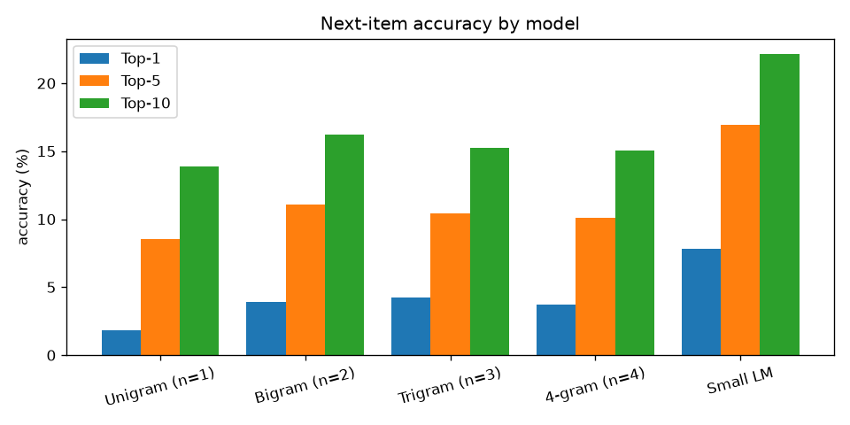
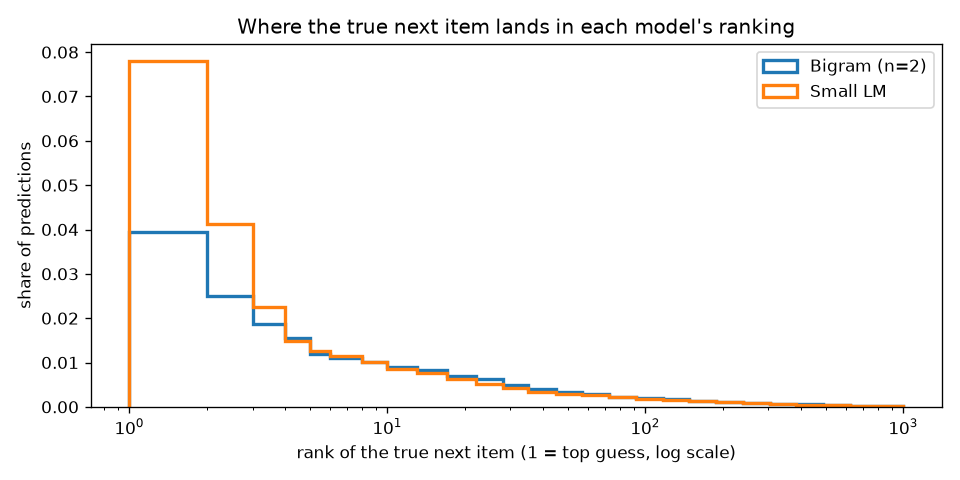

# Retail basket next-item prediction: n-gram vs small LM

Both models were trained on the same 80% of the simulated baskets and tested on the other 20%, read in the same random order. At each position the model ranks every catalogue item not yet in the basket; the rank of the true next item gives top-k accuracy, MRR and mean rank.

## Headline results

| Model | Top-1 | Top-5 | Top-10 | MRR | Mean rank | Median rank |
|---|---:|---:|---:|---:|---:|---:|
| Unigram (n=1) | 1.8% | 8.5% | 13.9% | 0.063 | 181.0 | 90 |
| Bigram (n=2) | 3.9% | 11.0% | 16.2% | 0.085 | 189.4 | 96 |
| Trigram (n=3) | 4.2% | 10.4% | 15.3% | 0.084 | 192.0 | 99 |
| 4-gram (n=4) | 3.7% | 10.1% | 15.1% | 0.080 | 192.1 | 99 |
| Small LM | 7.8% | 16.9% | 22.2% | 0.131 | 181.3 | 86 |

## Insights

- Overall, the Small LM is better: top-5 accuracy Small LM 16.9% vs Bigram (n=2) 11.0% (MRR 0.131 vs 0.085).
- Where the next item completes a planted itemset (8,017 positions), top-5 accuracy is 85.9% for the Small LM and 44.2% for the Bigram (n=2): the LM reads the whole basket so far, the n-gram only the last item(s), and basket order is random.
- On ordinary positions (43,030) both models fall back to popularity: 4.1% vs 4.9% top-5.
- N-gram orders ranked by MRR: Bigram (n=2) 0.085, Trigram (n=3) 0.084, 4-gram (n=4) 0.080, Unigram (n=1) 0.063. Longer contexts get sparse quickly with 1,000 items, so higher orders gain little or lose.

## Planted itemsets vs ordinary positions (top-5 accuracy)

| by_position | Unigram (n=1) | Bigram (n=2) | Trigram (n=3) | 4-gram (n=4) | Small LM |
|---|---:|---:|---:|---:|---:|
| planted | 27.5% | 44.2% | 41.6% | 40.1% | 85.9% |
| other | 5.0% | 4.9% | 4.6% | 4.5% | 4.1% |

## By category of the true next item (top-5 accuracy, 10 largest)

| by_category | Unigram (n=1) | Bigram (n=2) | Trigram (n=3) | 4-gram (n=4) | Small LM |
|---|---:|---:|---:|---:|---:|
| Fresh Produce | 27.0% | 26.4% | 21.4% | 20.8% | 33.3% |
| Staples | 4.0% | 9.2% | 10.4% | 10.0% | 17.7% |
| Dairy and Eggs | 0.0% | 5.1% | 6.8% | 6.5% | 11.2% |
| Spices | 0.0% | 1.7% | 2.5% | 2.4% | 5.7% |
| Snacks and Instant Food | 0.0% | 2.3% | 4.3% | 4.3% | 6.3% |
| Beverages | 3.5% | 7.0% | 8.0% | 7.7% | 12.9% |
| Pulses | 0.0% | 6.4% | 7.8% | 7.5% | 14.4% |
| Oils and Ghee | 24.6% | 19.5% | 13.9% | 13.5% | 16.8% |
| Bakery and Breakfast | 26.2% | 22.5% | 15.3% | 15.1% | 21.7% |
| Household and Cleaning | 0.0% | 5.3% | 7.6% | 7.5% | 15.9% |

## Charts

